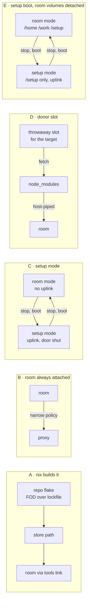

# RFC-001: How a sealed room gets a repo's package dependencies

## Context

A room has no uplink (`DEC-036`): no proxy, no resolver, no route. That is
its defining property. Plan E calls it "the design's best property arriving
for free". A slot, by contrast, has an allowlist proxy (`vm/capsule.nix`
sets `HTTP(S)_PROXY`), so a language package manager works there through
the policy's allowlist.

The symptom, in the `assistant` room on 2026-10-19:

```
[agent@capsule:/work/doctrine]$ session doctrine -- just web-build
cd web/map && bun install
error: DNSResolveFailed downloading tarball @eslint-community/eslint-utils@4.9.1
```

`bun` sees no proxy variables, tries to resolve the registry itself and finds
no resolver. The same recipe works in a doctrine slot. `IMP-019` records the
same gap for malebolge, whose `just check` runs npm-installed tools, and
`CHR-018` puts more such repos in the room. So the gap will recur for any
room repo whose tools come from a language package manager rather than nix.

Plan F §1 anticipated this and left it open: "if so, the room takes an
optional proxy on a policy whose allowlist names no git host". Plan E adds
that a room with egress "should declare a narrow selectable set, not
`everything`".

**The question:** what is the least mechanism that gets a room repo's
package dependencies into the room without giving the room's contents a way
out?

### An adjacent gap, whichever option is chosen

The room image has no `nix-ld` and no `LD_LIBRARY_PATH` for prebuilt
binaries. `vm/capsule.nix` has both, and says why: "a guest that cannot run
a binary it downloaded cannot run most toolchains". npm's prebuilt natives
(esbuild, rollup, biome) are exactly that. So `node_modules` arriving in a
room by any route below still won't run `web-build` until the room gets the
same loader. That is a separate, smaller decision, close to `IMP-020` (a
room repo gets its target's caches and `guestConfig`).

## Discussion

### Principles

The options are judged against these. P1–P4 are security. P5–P7 are the
house rules. P8–P9 are cost.

| | Principle | Source |
|---|---|---|
| **P1** | **Untrusted code and egress never coexist with the room's contents.** A host allowlist is not a one-way valve: an HTTPS `CONNECT` tunnel is opaque to tinyproxy, so it can't tell a download from an upload, and allowlisted hosts (npm, GitHub) accept uploads. | Plan E: "the allowlist would become an exfiltration path for anyone who got in" |
| **P2** | **Blast radius.** A slot holds one repo. A room holds N repos (more under `CHR-018`) plus every user's home. Whatever can reach egress can read all of that. | `DEC-036`, `CHR-018` |
| **P3** | **The mode is enforced host-side.** Anything that says whether a guest may reach egress lives on the host, not in the guest. | `POL-001` |
| **P4** | **Anything run with egress takes inputs the host chose.** A command fed a guest-writable `package.json`, `bunfig.toml`, `.npmrc` or login profile is not deterministic, whatever its argv. | new; follows from P1 |
| **P5** | **Nothing generic learns npm.** The setup command, if any, is a target's value. | `POL-002` |
| **P6** | **One declaration per axis.** A room already names a `policy` (`DEC-046`), and that policy's allowlist is currently unused. | `POL-003` |
| **P7** | **Reuse rather than a parallel implementation.** Slots, the proxy, `capsule-inject` and the netns uplink already exist. | house rule |
| **P8** | **Reproducibility.** Ideally the same lockfile always yields the same tree. | |
| **P9** | **Operator friction.** Per repo, per lockfile change. | |

### The options



**A — The repo's flake builds the dependency tree** (`IMP-019` shape 1). A
fixed-output derivation, or a lockfile importer, produces `node_modules` as
a store path. The repo's `toolsPackage` exports it, and the room reaches it
through `session`'s `tools` link. The room stays sealed and nothing in this
repo changes.
*Cost:* every repo does this work. For `bun.lock` (doctrine's `web/map`)
nixpkgs has no first-party importer, so it is third-party `bun2nix` or a
hand-maintained output hash that must be bumped on every lockfile change.
The user's word for this was "faffing", and for bun that is fair.

**B — The room is always attached to the proxy, on a narrow policy** (Plan F
§1 as written). `uplink` becomes a value a room may declare, and its policy's
allowlist becomes live.
*Cost:* it fails P1 and P2 outright. Every occupant, the agent included,
always has egress, and so does every repo and home in the room. A narrow
allowlist that admits only the npm registry still admits `npm publish` to
it. This option is in the RFC to be rejected on the record.

**C — Setup mode** (the user's proposal, 2026-10-19). The room has two modes,
and changing mode means stopping the VM and booting it again:

- **Room mode:** today's room. No uplink; the door is open to users.
- **Setup mode:** the netns is built with an uplink. The door refuses every
  declared user, nothing a user started runs, and one host-initiated setup
  command per repo runs, then the VM halts.

The room is never a room while it is attached. The reboot is the boundary:
it kills every process, and because the uplink is all-or-nothing when the
netns is built (`DEC-035`), the mode is a netns built with or without the
uplink, which is a host-side fact (P3).
*Conditions for it to meet P1–P4:*

1. Package scripts are off (`--ignore-scripts` / no `trustedDependencies`).
   Then the only code running with egress is the nix-built package manager.
   Lifecycle scripts and builds run later, offline, in room mode.
2. Inputs come from the host checkout at a named commit (what `capsule-room-git
   push` already delivers), not from the guest's working tree (P4).
3. It runs as a dedicated setup user with a clean environment and no login
   shell. Not `agent`, whose home and profile are writable from room mode.
4. Allowlist: the room's existing `policy` (P6). Its allowlist goes live in
   setup mode only.

*Residual risk:*

- A bug in the package manager's tarball or lockfile parsing, reached with
  `/work` and `/home` mounted. Small, but every repo and home is in reach (P2).
- Room mode can stage data on the volume, and setup mode's fetcher doesn't
  read it. That holds only while condition 1 holds.

*Cost:* new perimeter code (an optional uplink on a room record, a setup
boot, the door's refusal while it lasts, one setup verb). It supersedes
`DEC-036`'s "a room has no uplink" with "a room has no uplink while it is a
room".

**D — A donor slot fetches, the room receives.** A throwaway slot bound to
the same target runs the same script-free fetch with the same host-chosen
inputs, under that target's policy. The resulting tree is streamed
`ssh slot tar c | ssh room tar x` through the host, without the host ever
extracting it. The room is never attached.
*Meets P1–P4 by construction.* The fetch sees one repo (P2 is a slot's
radius), the room never has egress, and the untrusted tree runs only in the
sealed room. It reuses slots, the proxy and policies (P7).
*Cost:*
- A new guest-to-guest transfer. The room unpacks a guest-authored archive,
  so `pattern.oubliette.extracting-a-guest-authored-tree` applies on the
  room's side.
- A free slot is needed at setup time.
- The slot image and room image must agree on the ABI the tree's natives
  expect, which ties into the adjacent `nix-ld` gap.

**E — A setup boot that never attaches the room's volumes** (C refined,
2026-10-19, after the user weighed D's cost: provisioning a slot for 1 of n
repos every other run is tedious). It has C's shape, and it gets D's
radius by keeping the room's contents out of the guest instead of
confining them inside it. A bwrap or systemd sandbox inside the guest was
considered and set aside: that is guest-side, so under `POL-001` it is
convenience, and a guest kernel exploit from the fetcher defeats it.

```
setup mode:  room image ── fresh /setup only ──── uplink ───── door shut
room mode:   room image ── /home, /work, /setup ── no uplink ── door open
                           ▲ /setup read-only here, and the host discards it
                             before the next setup boot
```

1. **The inputs are declared files, sent by the host.** The target declares
   its setup as a value: an argv, and the input files it reads (e.g.
   `web/map/package.json`, `web/map/bun.lock`). The host extracts those from
   the named commit with `git show` and sends them over ssh. The fetcher never
   sees a repo, a home or a working tree, so P4 holds without any
   confinement.
2. **Every setup boot attaches only a fresh scratch volume.** The host
   creates it empty, and its only contents are what the host sends (item 1)
   and what the fetch writes. Which block devices are attached is the host's
   choice, in the Firecracker config, so this is perimeter (P3). A fetcher
   exploit, even with guest root, finds only public packages and manifests.
   Reaching a repo would need a hypervisor escape, as in D.
3. **The result goes one way, into the room, and the scratch never goes back
   to a networked boot.** Room mode attaches the scratch at `/setup`,
   read-only at the drive (a host-side flag, so guest root can't undo it). The
   finished tree moves from there into the clone with no egress. If any
   packages' scripts are needed, they run then (open question 5). The host
   discards the image before the next setup boot, so no block a room wrote
   ever reaches a guest with egress (RV-021 F-1). A cache retained across
   setups would need its own argument that no room-written block can enter a
   networked boot, including on retry and failure paths. None is proposed.
4. **One setup boot runs every stale repo.** Keep a record, per repo, of the
   fingerprint of its declared inputs at its last setup (item 1's files, not
   just the lockfile; see the drift bullet under Outcome). The verb runs only
   repos whose fingerprint differs, all in one boot. With nothing stale it is a no-op; otherwise it
   is one reboot round-trip however many repos are stale. No slot is needed.

*Residual risk:* a fetcher exploit has egress and the fresh scratch volume,
which holds this boot's fetched trees and declared input files: public
packages and manifests, not source. Untrusted code still runs in the room
later, but offline. All of this rests on item 3's discard. A scratch volume
shared between room mode and a networked boot is a return channel. The
first draft of E had one, and RV-021 F-1 caught it.
*Cost:* a scratch volume, a second boot shape, and the netns rebuilt with
an uplink on each mode switch. The rebuild is free, since the VM is stopped
anyway, and `DEC-035` allows it. The script-free fetch and host-chosen
inputs are the core shared with C and D. Unverified costs are open
questions 6 and 7.

### Comparison

| | A nix | B always on | C setup mode | D donor slot | E setup boot, volumes detached |
|---|---|---|---|---|---|
| P1 untrusted code ∦ egress | ✔ sandboxed | ✘ | ✔ if scripts off | ✔ | ✔ if scripts off |
| P2 radius at egress | none | whole room | whole room, fetcher only | one repo | a fresh scratch volume only |
| P3 host-enforced | ✔ | ✔ | ✔ reboot + netns | ✔ | ✔ reboot + netns + volume set |
| P4 host-chosen inputs | ✔ store | ✘ | condition 2 | condition 2 | ✔ declared files via `git show` |
| P5 nothing learns npm | ✔ | ✔ | command is a target value | command is a target value | command and inputs are target values |
| P6 one declaration | ✔ | uses `policy` | uses `policy` | target's policy | uses `policy` |
| P7 reuse | ✔ nothing new | new uplink | new uplink, mode, verb | new transfer | new uplink, boot shape, scratch volume, verb |
| P8 reproducible | ✔ hash | ✘ | lockfile only | lockfile only | lockfile only |
| P9 friction | high for bun | none | one verb, two reboots | one verb, a free slot | one verb, two reboots, only for stale repos |
| Supersedes `DEC-036` | no | yes | yes, narrowly | no | yes, narrowly |

### Where this leans (a proposal, not canon)

- **B** is out.
- **A** stays the right answer where an importer exists and a repo's owner
  wants hermetic builds. Nothing stops a repo doing it; it shouldn't be
  required.
- **C** and **D** share their core: a script-free fetch with host-chosen
  inputs, as a dedicated user, under a declared policy. They differ only in
  *where* that fetch runs. C runs it in the room (radius: every repo, for the
  fetcher's lifetime) and adds perimeter code. D runs it in a slot (radius:
  one repo) and adds a transfer. On the principles, **D dominates C**. C
  wins on not needing a free slot and not needing the two images to agree.
- The shared core should be built once either way: the setup command as a
  target value, plus the conditions. Then the C-or-D choice is about where it
  runs, not a second implementation.
- **E supersedes C and is preferred over D** (user, 2026-10-19: "I like
  it"; superseded in turn by the Outcome). It keeps C's convenience: no slot, and one boot covers every stale
  repo. It matches D's radius, since the room's volumes are not attached
  while there is egress, and the scratch that is attached is fresh each time. It also tightens P4 beyond both, since the fetcher
  sees declared files rather than a checkout. D stays the fallback if E's
  boot-shape costs (questions 6–7) prove prohibitive.

## Outcome

**Resolved 2026-10-19: option A, as policy `POL-005` ("A room never
fetches").** The user agreed after a survey of the three room repos showed A
mostly built already: doctrine's `webModules` fixed-output derivation over
`bun.lock`, malebolge's `buildNpmPackage` (production dependencies only), and
www's `bundlerEnv` over `gemset.nix`. So the *mechanism* exists in all three.
The artefacts don't, quite: doctrine's and www's need exporting plus a recipe,
but malebolge's tree prunes its development dependencies, which are exactly
the tools `just check` runs. Malebolge needs a second output, a complete
development tree, accepted when `just check` passes in a sealed room
(RV-021 F-3). A is also the existing floor rule: a tool a project
builds or tests with belongs in its flake (`docs/contract-flavour.md`). E's
convenience doesn't yet pay for its perimeter code.

What A costs, accepted with it:

- **A dependency change is a round-trip:** lockfile, hash, push, consumer
  lock, room rebuild. That is heavier than E's verb, and it is the trigger to
  revisit.
- **Hash maintenance for bun** (doctrine's `just web-hash`). For npm,
  `importNpmLock` needs none.
- **Drift:** the clone's dependency inputs can differ from those the locked
  tree was built from. A lockfile hash alone doesn't catch it. Changing
  `package.json` without regenerating the lockfile leaves the hash matching,
  and no install runs in the room to reject the mismatch (RV-021 F-2). Guard:
  a repo-owned fingerprint over every input that determines the tree
  (manifests and lockfiles, plus workspace manifests, patches and
  package-manager config where they apply). It is bound into the output and
  checked by the repo's recipe before the tree is used. The negative case to
  verify is a manifest-only change. Which files count is the repo's
  knowledge, so oubliette learns nothing (`POL-002`).
- **Unverified:** tools that write into `node_modules` (vite's `.vite`), and
  native binaries in a room with no `nix-ld`.

**E is deferred, not rejected.** It is the escape hatch `POL-005` names, if a
repo's ecosystem can't be packaged or dependency churn in the room makes the
round-trip dominant. Questions 6–8 below are E's, and stay open for that day.
D stays E's fallback.

The questions as they stood when A was chosen:

1. ~~C or D.~~ Answered by E. The risk C carried, every repo in reach of
   the package manager's parser, is removed by not attaching the room's
   volumes rather than by moving the fetch to a slot.
2. **Where the setup command is declared.** A target field, e.g. a
   `setup` argv run in the repo root with scripts off. It must be a value,
   with a working absent path (`POL-002`). `docs/contract-target.md` moves
   with it.
3. **Does the recipe still fetch?** `just web-build` runs `bun install`
   itself. With a populated `node_modules` and a frozen lockfile, does bun
   stay offline, or does the recipe need an offline flag in the room? Unchecked.
4. **The loader gap** (Context, above). Does the room take `vm/capsule.nix`'s
   `nix-ld` and `LD_LIBRARY_PATH`, as a shared fragment rather than a second
   copy?
5. **Scripts that some packages need** (esbuild's postinstall, native
   addons). Do they run offline in room mode as a second, egress-free step,
   and is that step also a target value?
6. **E: one image or two.** microvm.nix turns its volume list into the
   guest's `fileSystems`, so the volumes are part of the guest's system
   closure. A boot missing `/home` and `/work` would hang on mount unless they
   are `nofail`, or setup mode is a second image built from the same room
   declaration. A second image is likely cleaner, but each room then costs two
   builds. Which identity does a second runner take, given a VMM is
   identified by its namespace (`fact.oubliette.dead-guest-is-not-a-dead-vm`)?
7. **E: what the setup boot must not start.** The first-boot seed writes to
   `/home`, and sshd's host keys live in `/home/.ssh-host-keys`
   (`vm/room.nix`). The door refuses users in setup mode, but the host still
   needs a key-authenticated way in to run the fetch. That means host keys
   that do not live on a detached volume, and a known-hosts entry that
   doesn't conflict with room mode's.
8. **E: the staleness record.** Where does the record of the input
   fingerprint at each repo's last setup live? On the host (the front end's act, per
   `POL-003`), or on the scratch volume (guest-writable, so only a hint)?

## References

- `DEC-036` — a room is a guest record with no uplink
- `DEC-035` — the netns uplink is all or nothing
- `DEC-046` — a room's `policy`, whose allowlist is unused today
- `DEC-049` — `session` and the repo tree
- `IMP-019` — a room repo whose tools are npm packages cannot install them
- `IMP-020` — a room repo gets its target's caches and `guestConfig`
- `CHR-018` — the assistant room holds the rest of the user's repos
- `POL-001`…`POL-004`
- `docs/plan-e-room.md` (the room has no way out), `docs/plan-f-assistant.md` §1
  (the optional proxy on a narrow policy)
- `vm/room.nix`, `vm/capsule.nix` (proxy variables, `nix-ld`), `vm/door.nix`
  (no resolver)
- `pattern.oubliette.extracting-a-guest-authored-tree`
