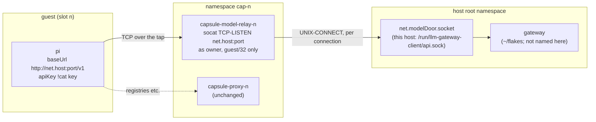
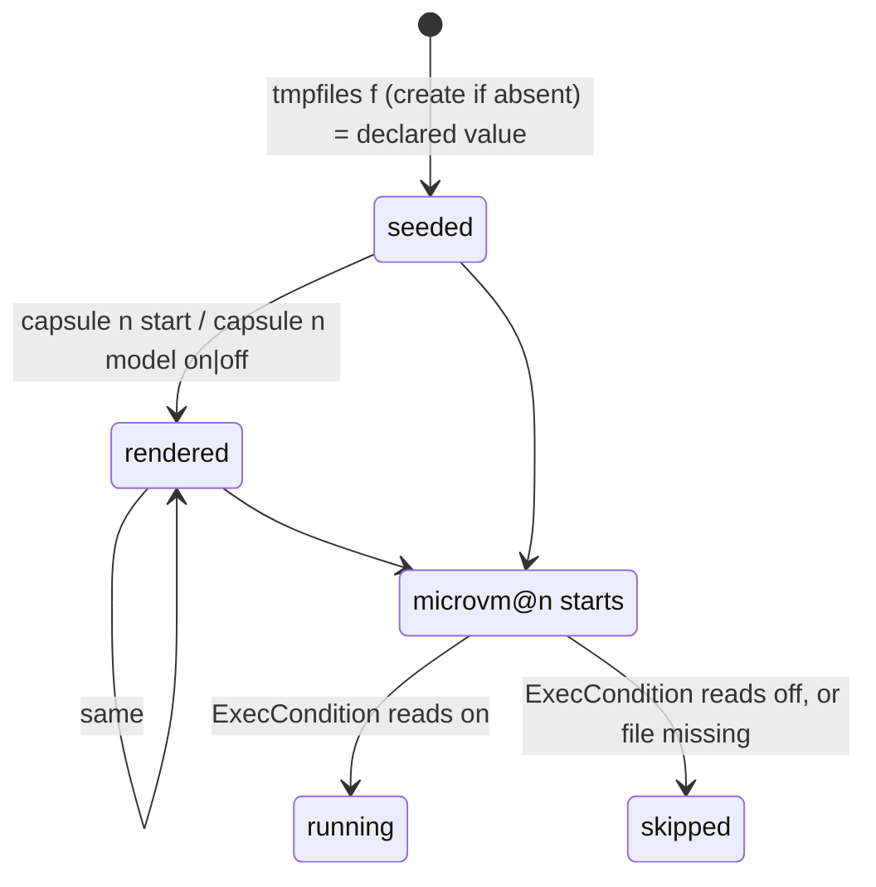

<!-- doctrine:section sec-1 -->
## Shape

A slot gains an optional **model door**: a TCP port on `net.host`, inside the
slot's network namespace, that leads to a unix socket on this host where an
LLM gateway listens. pi in the guest points its base URL at the door and
presents a gateway key it was handed by inject. Nothing routes: the door is a
host process that holds both ends, so the guest still has no way out but the
proxy, the forward drop and the guard keep their meaning (`POL-001`), and the
key's model list and budget are the gateway's control, held host-side.

The mirror image of the ssh relay, which is socat in the namespace from a host
socket *in* to the guest's port 22; this one is socat in the namespace from the
guest's side *out* to a host socket.



The edge that matters is the one that is *not* there: no unit here orders
itself after, requires or names the gateway (`DEC-070`). socat with `fork`
connects to the socket once per accepted connection, so a gateway that is down
is a refused request in the guest, not a failed unit on the host.

Four pieces, in dependency order:

| section | piece | decisions |
|---|---|---|
| sec-2 | the declaration — `fleet` slot field `modelDoor`, `net.modelDoor` — and its eval-time refusals | `DEC-069`, `DEC-071` |
| sec-3 | the relay unit and its place in the `microvm@` drop-in | `DEC-070`, `DEC-072` |
| sec-4 | run-time state, the verb `capsule <n> model on\|off`, the status column | `DEC-069`, `DEC-072` |
| sec-5 | the guest side, which is the consumer's inject payload | `DEC-073` |

Out of the picture entirely: the guest image (`vm/` is unchanged), the
devshell path (`capsule-host` gets no door), rooms (sec-8), and the gateway.

<!-- doctrine:section sec-2 -->
## The declaration and its refusals (`DEC-069`, `DEC-071`)

Two axes, each with its one home (`POL-003`):

| axis | home | shape | absent means |
|---|---|---|---|
| addressing | the caller's `net` | `modelDoor = { port = <int>; socket = "<abs path>"; }` | no slot on this host may have a door |
| slots | the caller's `fleet` (a consumer's `capsules.nix`) | `<slot>.modelDoor = "on" \| "off"` — the door's state at start | that slot has no relay unit, no state file, no grant, and the verb refuses for it |

```nix
# net.nix (consumer, this host)
modelDoor = { port = 4000; socket = "/run/llm-gateway-client/api.sock"; };
# capsules.nix (consumer)
a = { index = 0; policy = "build"; policies = ["build" "sealed"]; modelDoor = "on"; };
```

`capsules.nix`'s `recordOf` destructures a closed argument set, so the field is
added there (`modelDoor ? null`) and carried into the instance record; without
that it is silently dropped. Nothing else in `capsules.nix` changes.

### One pure file for the refusals: `model-door.nix`

The refusals cross two axes (a slot field against `net`), so they belong to
neither `capsules.nix` nor `net`, and get their own file in `state-dir.nix`'s
shape: pure, `{lib}: {modelDoor, slots, proxyPort}: {reasons; value;}`, where
`value` is `net.modelDoor` (or `null`) and throws the first reason, and
`reasons` exposes each verdict's exact string so a suite asserts *why*
(`fleet.nix`'s `reasons` arrangement). `mkfleet.nix` reads `value` where it reads
`stateDir`'s, so every caller's eval refuses, the consumer's included.

Refused, each with a message naming the field, the value and the decision:

1. a slot's `modelDoor` that is not `"on"` or `"off"`;
2. a slot declaring `modelDoor` while `net.modelDoor` is absent;
3. a port that is not an integer in 1–65535, or equals `net.proxyPort` or 22 —
   the range check is an addition to `DEC-071`'s list, conventional and
   reversible, made because the port is spliced into socat's address text;
4. a socket path that fails the host-path refusal below.

### D-4 resolved: the path refusal fits, its message does not

`state-dir.nix`'s test — absolute, every character in `[A-Za-z0-9._+/-]`, every
component a name (not empty, `.` or `..`) — accepts
`/run/llm-gateway-client/api.sock` (checked by reading `state-dir.nix`; it
asks nothing about directories). It is also the right test for a different
reason here: socat parses `,` as an option separator and `:` as an address
separator, and the set excludes both, so a passing path is one socat reads as
one path. What does not fit is the message, which names "mkFleet's stateDir".

So the predicate moves out, and nothing is written twice:

```nix
# host-path.nix — the one spelling of "a path this host can splice".
{lib}: {
  allowed = "A-Za-z0-9._+/-";
  why = path: null | "is not absolute" | "contains \"…\"" | "has a component that is not a name: \"…\"";
}
```

`state-dir.nix` keeps its interface and its exact message, built from `why`;
`stateDirCases`, unchanged, is the regression check on the move.
`model-door.nix` builds its own message from the same `why`.

### What is not enforced

A sealed slot (one whose policy fetches nothing) may still declare a door —
`DEC-069`'s stated consequence. It is visible in `status` (sec-4) and a
consumer may assert it against its own policy names; an optional policy
ceiling is later work, not this slice.

<!-- doctrine:section sec-3 -->
## The relay unit (`DEC-070`, `DEC-072`)

One unit per slot that declares `modelDoor` (either value), built
`perInstance` beside `relayServices` in `host/services.nix`. `perInstance`, not
`perGuest`: a room has no `modelDoor` field yet, and reading one with `or null`
would be a field nobody declared (sec-8).

```nix
withDoor = lib.filter (c: c.modelDoor != null) instances;
modelRelayServices = lib.listToAttrs (map (c: {
  name = "capsule-model-relay-${c.name}";
  value = {
    description = "model door for capsule ${c.name}, to a host socket";
    bindsTo = [(netnsUnit c) (tapUnit c)];
    after   = [(netnsUnit c) (tapUnit c)];
    serviceConfig = {
      ExecCondition = "${pkgs.gnugrep}/bin/grep -qx on ${modelDoorOf c}";   # sec-4
      ExecStart = "${pkgs.socat}/bin/socat TCP-LISTEN:${toString net.modelDoor.port},bind=${net.host},fork,reuseaddr,nodelay UNIX-CONNECT:${net.modelDoor.socket}";
      User = cfg.owner;
      NetworkNamespacePath = netns.nsPath c.ns;
    } // relayHardening;   # shared with the ssh relay (below): UMask … RestartSec,
                           # including IPAddressAllow guest/32, IPAddressDeny any,
                           # SuccessExitStatus 143
  };
}) withDoor);
```

Line by line, where the reason is not the ssh relay's:

- **`bindsTo` the tap as well as the namespace** — the namespace unit stays
  `active exited` after a VM stops, and a relay bound to it alone outlived
  every stopped capsule (NOTES item 40). Same reason as the ssh relay.
- **No `after`, `requires` or `wants` on any gateway unit** (`DEC-070`): that
  would name a `~/flakes` unit in generic code (`POL-002`). `hostModuleUnits`
  pins the unit's ordering lists to exactly the namespace and the tap.
- **`bind=${net.host}`**: the address exists once the tap's `ExecStartPost`
  (`capsule addr`) has run, which `after` the tap guarantees; the proxy binds
  the same address under the same ordering. `reuseaddr` so a stop/start in
  quick succession (the verb) is not refused by a socket in `TIME_WAIT`.
  `nodelay` because pi streams tokens as small chunks and socat sets no
  `TCP_NODELAY` — the ssh relay's measured Nagle stall (`docs/probes.md`,
  "keystroke echo") is the same mechanism.
- **As `cfg.owner`, no group, no `DynamicUser`** (`DEC-070`). The only
  assumption is a unix socket the owner can open — the ssh relay's assumption.
  On this host that holds because `~/flakes`' client socket is `SocketUser =`
  the human, mode 0600 (research ✓). If `cfg.owner` is not that user, every
  connection fails `EACCES` and the unit stays up: a misconfiguration that
  reads as a gateway refusal in the guest, named in sec-8.
- **`ProtectSystem = "strict"` does not block the connect.** A read-only mount
  refuses writes to regular files, directories and symlinks; `connect()` on a
  socket inode is exempt. Inferred from the kernel's permission rule, not run;
  the live exercise (sec-6) is what verifies it.
- **`IPAddressAllow = guest/32`** is the control that bounds who can reach the
  listener. The namespace's input chain is `policy accept` toward `net.host`
  (`host/netns.nix:259-262`, research ✓), so nft does not bound it; the unit does.
  It applies to `AF_INET` only, so the unix connect is unaffected.

**The hardening block is shared, not copied.** The ssh relay's
`serviceConfig` keys from `UMask` to `RestartSec` move into one `relayHardening`
attrset in `host/services.nix` that both relays merge; the ssh relay keeps its
`RuntimeDirectory` (the model relay listens on no socket file, so has none) and
`RestrictAddressFamilies` is `AF_INET AF_UNIX` for both.

### Its place in the `microvm@` drop-in

```nix
wants = lib.optional (c.uplink != null) (proxyUnit c)
     ++ [(relayUnit c)]
     ++ lib.optional (c.modelDoor != null) (modelRelayUnit c);
```

On the declaration, not on the state: a declared door is always *wanted*, and
the `ExecCondition` decides whether it runs (sec-4, D-1). It is independent of
`c.uplink`, so IMP-029's uplink-less slot keeps its door.

### D-6: where the far end is

The socket path is the caller's value and the only place the gateway appears.
On this host it is `/srv/fleet`'s `net.nix` naming
`/run/llm-gateway-client/api.sock` — `~/flakes`' relay listener
(`flakes:DEC-075`), not the gateway's own 0750-gated socket. The gateway serves
`/v1/chat/completions` and `/v1/models` only, so the door carries the
OpenAI-compatible chat API and nothing else; that bounds IDE-004, not this
slice. The user rebuilds `~/flakes` and `/srv/fleet`; nothing here does.

<!-- doctrine:section sec-4 -->
## Run-time state, the verb and status (`DEC-069`, `DEC-072`)

### D-1 resolved: the unit reads one rendered bit, the front end resolves it

A static `wants` alone would bring an `off` slot's door back at its next VM
start. So the decision of whether the relay *runs* is read at start, from a
file the unit can reach — the allowlist link's arrangement
(`host/services.nix`'s `allowlistDir`), one bit instead of a symlink:

```
/var/lib/capsule-model-door/            0755 owner:users   (new option modelDoorDir)
  a                                     "on\n" | "off\n"   0644 owner:users
```



- **Who writes it.** tmpfiles `f <modelDoorDir>/<n> 0644 owner users - <declared>`
  seeds it once (create-if-absent, so an override survives a reboot, as the
  allowlist link's `L` does). The front end writes the *effective* value —
  the record's `model_door` override, else the declared value — at
  `capsule <n> model on|off` and at every `capsule <n> start`, before the VM.
- **Who reads it.** Only the relay's `ExecCondition`, which resolves nothing:
  `grep -qx on`. A missing or unreadable file skips the unit, so the absent
  path is closed. A skipped condition leaves the unit `inactive`, not `failed`,
  and `Restart=on-failure` does not fire.
- **Why the front end also renders at start.** A seed that is create-if-absent
  never learns that the operator changed a slot's declared value from `on` to
  `off`; without the re-render that slot keeps its door, which is the fail-open
  direction. Writing at `start` closes it for every start through the front
  end. **Residual, stated:** a bare `systemctl start microvm@<n>` after such a
  change, with no front-end start since, reads the stale render. The policy
  link has the same residual today (its `L` keeps an old link when the declared
  default moves); that is recorded as a backlog item, not fixed here.

Resolution stays the front end's act (`POL-003`); the unit only reads what it
was told, as the proxy reads only its link.

### The verb: `capsule <n> model [on|off]` (D-2)

Copies `policy`'s shape, and its refusal order, so the two verbs refuse
alike — including the known divergence between the module's copy and the
devshell's (`mem.fact.oubliette.two-copies-refuse-in-different-orders`):

| # | condition | outcome |
|---|---|---|
| 1 | no argument | print the effective state: `on`, `off`, or `-` for a slot with no door (`slotPolicy`'s token for "nothing declared") |
| 2 | not exactly one of `on`, `off` | refuse: usage |
| 3 | the slot declares no `modelDoor` | refuse: "declares no model door; that is the host operator's, in capsules.nix" |
| 4 | `CAPSULE_MODEL_DOOR_DIR` unset (not the module's copy) | refuse, naming `/run/current-system/sw/bin/capsule`; the devshell path has no door |
| 5 | otherwise | `recordWrite n '.model_door = $v'` with a `recordAlso` hook |

The hook, under the record's lock, before the record is written:

1. remember the file's previous content, write the new value;
2. if `microvm@<n>` is not active: done — the next start reads it. Starting
   the relay now would pull its `bindsTo` tap and namespace up with no VM;
3. else `sudo systemctl start|stop capsule-model-relay-<n>`;
4. if that fails: restore the previous content, return 1, so no record is
   written and the refusal says the door did not move. The `off` case is why:
   a record saying `off` over a running door is fail-open (NOTES item 41's
   rule for the proxy).

Everything prints to stderr, as in `policy`'s hook, because the hook runs
inside `gen=$(recordWrite …)`.

**The grant.** Step 3 needs root: two literal sudoers commands per slot that
declares a door, `systemctl start` and `systemctl stop` of its relay, in the
same `mkAfter` rule as the proxy restart (NOTES item 43). `host/proxy-restart.nix`
becomes `host/unit-command.nix`, `verb: unit: "/run/current-system/sw/bin/systemctl ${verb} ${unit}"`
— one spelling for the front end, the grant and the check — and
`mkfleet.nix`'s `unrestartable` becomes `ungranted`, covering the proxy restart
and both relay verbs. The verb is owner-only in fact, as `policy` is
(`mem.fact.oubliette.policy-verb-is-owner-only`): the record's lock, the
state directory and the grant all name `cfg.owner`.

**The record.** `host/record.nix`'s skeleton gains
`.model_door = (.model_door // null)`; `null` reads as `-`, "as declared".
Like `policy`, an override outlives a re-assignment: the door belongs to the
slot (`DEC-073`'s consequence), not to the project on it.

**The wrapper.** `host/wrap.nix`'s `paths` gains `modelDoorDir`, exported as
`CAPSULE_MODEL_DOOR_DIR`; `wrapCases` asserts it survives to the program.

### D-3: the status column

`capsule all status` gains `model` after `relay`: the relay's `unitState`,
which is `--` for a slot with no door (no unit loaded), `inactive` for one that
is off or whose VM is down, `running` for an open door. The desired state is
the verb's no-argument answer and stays off the table. The column is always
present — `host/cli.nix`'s rule of one format and no column that comes and goes
(NOTES item 51 decision 3) — and it makes a wide table one column wider.
IMP-009 is the fix for the width; this slice appends a note to it and does not
reshape the table.

<!-- doctrine:section sec-5 -->
## The guest side is the consumer's (`DEC-073`)

Oubliette ships no guest code for pi or the key: a slot may not select a
`guestModule` fragment (`fragments.nix`'s `slotRefusal`, `DEC-060`), and
`guestConfig` is not a target field. Inject already moves opaque, per-`$capsule`
payloads, and a `dest` under `$HOME` is removed by the guest's home reset and
written again at every start, so a revoked or re-issued key reaches the guest
at the next start without `--force`.

The template (`templates/fleet/setup.nix`) carries the example, commented as
its `claude-credentials` entry is; the fixture carries a live one so the shape
evaluates. `setup.nix` imports the consumer's own `./net.nix` for the address
and port rather than spelling them a second time.

```nix
# templates/fleet/setup.nix — two entries, plus three lines in the env file
{
  name = "gateway-key";                      # issued on the host per slot:
  dest = "${home}/.config/llm-gateway/key";  #   llm-gateway issue capsule-$capsule --models … --budget … --out …
  optional = true;
  produce = ''cat "${mine}/$capsule.gateway-key"'';
  tools = [];
}
{
  name = "pi-models";
  dest = "${home}/.pi/agent/models.json";
  produce = ''jq -n --arg url "http://${net.host}:${toString net.modelDoor.port}/v1" \
    --arg key "!cat ${home}/.config/llm-gateway/key" '{ providers: { gateway: {
      baseUrl: $url, api: "openai-completions", apiKey: $key, authHeader: true,
      models: [ … the consumer's model ids … ] } } }' '';
  tools = ["jq"];
}
# and in the env entry's file (<volumePath>/.env, sourced at login):
#   PI_OFFLINE=1  PI_SKIP_VERSION_CHECK=1  PI_TELEMETRY=0
```

### D-5 resolved: what each line rests on

| line | evidence | rung |
|---|---|---|
| `apiKey: "!cat …"` reads the key at request time | pi 1.5.0 `docs/models.md:65` (research ✓) | read |
| `authHeader: true` | default is `false` (`models-configuration.md:22`, ✓); the host's working provider omits it, so Bearer-without-it is **inferred**. Setting it explicitly makes the example rest on the documented behaviour rather than the inference | read; verified only by the live run |
| `PI_OFFLINE`, `PI_SKIP_VERSION_CHECK`, `PI_TELEMETRY=0` | `environment-variables.md:84-87`, `settings.md:171` (✓) | read |
| no `packages` in `settings.json` | pi tries npm at startup, warns, skips and runs on (`packages.md:19`, ✓); the example ships no `settings.json`, so there is nothing to try | read |
| the base URL bypasses the proxy | `vm/capsule.nix:178-183` puts `net.host` in `NO_PROXY` | read |
| `models.json`'s outer shape (`providers.<name>.{baseUrl, api, apiKey, models}`) | the host's own file, structure only (✓) | read |

The model ids are the consumer's and must be a subset of what the key was
issued for; the gateway refuses the rest.

<!-- doctrine:section sec-6 -->
## Verification

Four kinds of check (CLAUDE.md), each covering a different verb of evidence
(`STD-001`). All are in `just build`; each new case is checked by mutating
its subject and watching it go red.

| check | kind | what it pins | what it cannot see |
|---|---|---|---|
| `hostModuleUnits` | evaluates the module | over a fixture net with `modelDoor` on a nobody's socket (`/run/fixture-model-door/api.sock`) and three fixture slots — `on`, `off`, undeclared | anything at run time |
| `modelDoorCases` (new, `model-door-cases.nix`) | eval verdicts, `builtins.tryEval` + `deepSeq`, asserted in the shell | each refusal of sec-2 and its exact reason | — |
| `stateDirCases` | unchanged | `state-dir.nix`'s verdicts and messages after the predicate moves to `host-path.nix` | — |
| `policyCases` (extended) | runs the shipped front end's text over a fixture pool | the verb's refusals in order, and the record and state file moving together | the `sudo systemctl` leg (below) |
| `wrapCases` | composition | `CAPSULE_MODEL_DOOR_DIR` survives the wrapper | — |
| live, the user's | exercise | the wire | — |

### `hostModuleUnits` cases

- `capsule-model-relay-<on>` and `-<off>` exist; none exists for the undeclared
  slot.
- Its `ExecStart` is exactly the one line of sec-3, with the fixture's port and
  socket; its `ExecCondition` names `<modelDoorDir>/<n>`.
- `bindsTo` and `after` are exactly `[netns tap]`, and no ordering list names
  anything else (the "names no gateway unit" pin).
- `User = owner`, `IPAddressAllow = [guest/32]`, `IPAddressDeny = any`,
  `SuccessExitStatus = 143`, and the shared hardening keys equal the ssh relay's.
- The `microvm@` drop-in `wants` the relay for both declaring slots and not for
  the undeclared one.
- tmpfiles carries `d <modelDoorDir> 0755` and one `f` per declaring slot whose
  argument is its declared value.
- `ungranted` is empty: the sudoers rule holds both relay verbs per declaring
  slot, by `host/unit-command.nix`'s spelling.

### `modelDoorCases`

One round per refusal in sec-2 (bad slot value; slot door with no
`net.modelDoor`; port 22, `proxyPort`, 0, 65536, a string; a socket that is
relative, holds `,`, holds `:`, holds `..`), each asserting the verdict and the
message, plus an accepted declaration whose `value` is the input. Its subject
is `model-door.nix` itself, handed fixture values no host declares, and it is
wired into `just build` and `just cases` in the same commit (NOTES item 51
step 3).

### `policyCases`, extended rather than copied

The model verb is the policy verb's sibling — same front end, same record, same
lock, same hook shape — so its rounds go in the suite that already renders the
front end over a fixture pool, rather than a fourth render of it
(`policyCases`, `volumeCases` and `roomVerbsCases` already render their own).
The fixture pool gains `modelDoor` on two of its slots and a `net.modelDoor`.
Rounds:

- each of refusals 1–4 in order, with its reason, including refusal 3 for a
  slot that declares no door and refusal 4 on a copy with no state directory;
- `on`/`off` on a slot whose VM is not running writes the record's
  `model_door` and the state file together, prints the not-running line, and
  leaves no other trace;
- no argument prints the declared value before any override and the override
  after one;
- `start` renders the state file from the declaration when the record holds no
  override.

**Not reachable in the sandbox, named:** the running-VM branch — `sudo
systemctl start|stop` and the undo when it fails. `systemctl` and `sudo` are in
the front end's `runtimeInputs`, so no stub can stand in, and that boundary is
respected rather than worked around. The live run covers it.

### Live, the user's (`exercise`)

After the user rebuilds `/srv/fleet` with a door on one slot, a sequence whose
verdicts land in `docs/probes.md`, each leg in both directions (`ADR-003`):

1. in the slot, `curl` with the key to `http://net.host:<port>/v1/models` → 200;
   without the key → the gateway's 401 (the door carries, the gateway gates);
2. `net.host:<another port>` → refused (the door is one port, not the host);
3. pi completes one request through the door;
4. `capsule <n> model off` with the VM up → the port is refused and status says
   `inactive`; `capsule <n> model on` → it answers again;
5. `microvm@<n>` restarted while `off` → still refused (D-1's condition);
6. a slot with no `modelDoor` → refused on the port, status `--`.

<!-- doctrine:section sec-7 -->
## Contracts and governance text that moves

Same commit as the unit (`POL-002`'s rule for the boundary):

- **`docs/contract-target.md:324`** — "There is no route out except the proxy,
  and therefore no host service reachable by address" becomes: no route out
  except the proxy, and **the only host service reachable by address is a
  declared model door, on its declared port, to a socket the host operator
  names**. `:336`'s neighbouring wording follows.
- **`docs/contract-assignment.md`** — the record's `model_door` field: `"on" |
  "off" | null`, written only by the verb, `null` meaning as declared.
- **`docs/plan-f-assistant.md` §2** — annotated: the slot half of IDE-003 is
  SL-010; the room half is still open.
- **`templates/fleet/README.md`** — a short "a model door" section beside the
  inject docs: the two declarations, the issued key, the env lines.
- **`CLAUDE.md`** — `modelDoorCases` in the suite list.

Governance readings, not edits:

- **`POL-001`.** The door is not a route and not egress in the perimeter's
  sense: a host process holding both ends, bounded by `IPAddressAllow`, to one
  socket. The forward drop and the guard are unchanged. It is egress *in
  substance* — guest content reaches a provider — and the gateway key's models
  and budget are the control (`DEC-069`'s context).
- **`POL-003`.** The addressing row's list (tap, addresses, MAC, proxy port)
  and the slots row's list both grow by one field. That is a revision of the
  policy's table, proposed at reconcile through `doctrine revision`, not an
  edit here.
- **`POL-002`, `POL-004`.** No gateway name, port or path in generic code; the
  new suite takes its subject as an argument.
- `ADR-002`: no ledger item. `ADR-003`: the live figures go to
  `docs/probes.md` and say what they do not prove.

<!-- doctrine:section sec-8 -->
## Risks and what is out of scope

- **A second way out beside the proxy.** A guest with a door can spend its
  key's budget on its key's models. Accepted; the key's limits are the control
  and they are host-side. RSK-013 (an OAuth credential in a capsule) is
  unchanged.
- **A sealed slot can declare a door** (sec-2). Visible, not enforced.
- **`cfg.owner` must be the far socket's owner.** Otherwise each connection
  fails and the unit stays up, which reads in the guest as a gateway error.
  The module cannot check another flake's `SocketUser`; the README says it.
- **Inferred, verified only live:** that `connect()` works under
  `ProtectSystem=strict`; that pi sends Bearer with `authHeader: true`; that
  `ExecCondition`'s skip leaves the `microvm@` start unaffected.
- **The stale-render residual** (sec-4): a bare `systemctl start microvm@<n>`
  after a declared-value change, with no front-end start between. Shared with
  the policy link; a backlog item for both.
- **Status width** (IMP-009): one column wider.

Out of scope:

- **Rooms.** A room has no `modelDoor` field and no inject path; the unit is
  `perInstance` until it does. Moving it to `perGuest` is the follow-up, with
  `POL-005`'s reading ("a room never fetches").
- **The devshell path.** `capsule-host` gets no door; the verb refuses there.
- **IMP-029** (a slot with no proxy or uplink). The door does not depend on
  the uplink, so it is ready for it.
- **IDE-004.** claude and codex speak `/v1/messages` and `/v1/responses`, which
  the gateway does not serve.
- **A policy ceiling** on the door, and any change to the gateway.

<!-- doctrine:section sec-9 -->
## Code impact

| path | change |
|---|---|
| `host-path.nix` (new) | the path predicate and character set, moved out of `state-dir.nix` |
| `state-dir.nix` | builds its unchanged message from `host-path.nix` |
| `model-door.nix` (new) | the four refusals; `reasons`, `value` |
| `model-door-cases.nix` (new) | `modelDoorCases` |
| `capsules.nix` | `recordOf` carries `modelDoor ? null` |
| `host/services.nix` | `modelRelayServices`; shared `relayHardening`; the drop-in's `wants`; `modelDoorDir` option; tmpfiles `d` + `f`; the two grants per declaring slot; `paths` to the wrapper |
| `host/unit-command.nix` (renamed from `proxy-restart.nix`) | `verb: unit:` |
| `host/cli.nix` | the `model` verb; `effectiveModelDoor`; the render at `start`; the `model` status column and header; the proxy restart through `unit-command.nix` |
| `host/record.nix` | `model_door` in the skeleton |
| `host/wrap.nix` | `CAPSULE_MODEL_DOOR_DIR` from `paths.modelDoorDir` |
| `host/policy-cases.nix` | the model verb's rounds; fixture slots and `net.modelDoor` |
| `host/wrap-cases.nix` | the new variable survives |
| `mkfleet.nix` | `model-door.nix`'s `value` read beside `stateDir`'s; `hostModuleUnits` fixture and cases; `ungranted`; `modelDoorCases` wiring |
| `just/fleet.just` | `modelDoorCases` in `build` and `cases` |
| `justfile` | `host-path.nix`, `model-door.nix`, `model-door-cases.nix` in `nix_paths` (it lists root files by name) |
| `fixture/default.nix` | a door on one fixture slot; the fixture's inject example |
| `templates/fleet/net.nix`, `capsules.nix`, `setup.nix`, `README.md` | commented examples (sec-5) |
| `docs/contract-target.md`, `docs/contract-assignment.md`, `docs/plan-f-assistant.md`, `CLAUDE.md` | sec-7 |
| `docs/probes.md` | the live verdicts, after the user's run |

Unchanged on purpose: `vm/`, `fragments.nix`, `host/netns.nix`,
`perimeter/`, `rooms.nix`, `capsule-host`.

