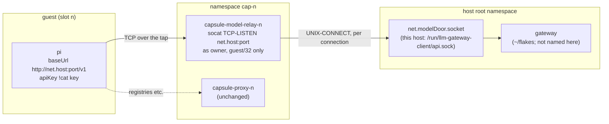
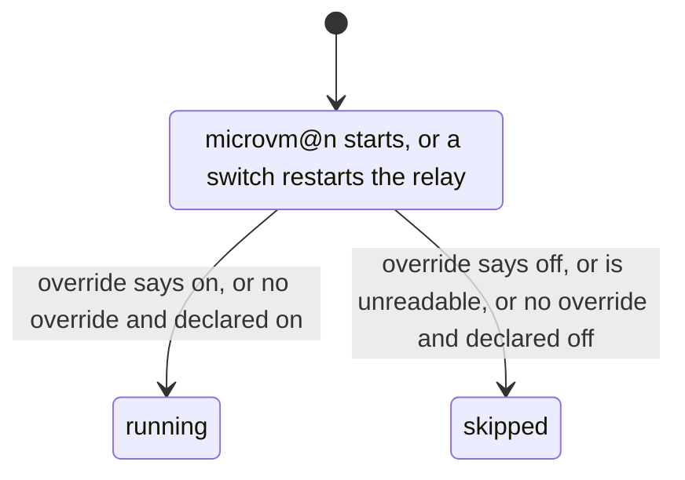

<!-- doctrine:section sec-1 -->
## Shape

A slot gains an optional **model door**: a TCP port on `net.host`, inside the
slot's network namespace, that leads to a unix socket on this host where an
LLM gateway listens. pi in the guest points its base URL at the door and
presents a gateway key it was handed by inject. Nothing routes: the door is a
host process that holds both ends, so the guest still has no way out but the
proxy, the forward drop and the guard keep their meaning (`POL-001`), and the
key's model list and budget are the gateway's control, held host-side.

The mirror image of the ssh relay, which is socat in the namespace from a host
socket *in* to the guest's port 22; this one is socat in the namespace from the
guest's side *out* to a host socket.



The edge that matters is the one that is *not* there: no unit here orders
itself after, requires or names the gateway (`DEC-070`). socat with `fork`
connects to the socket once per accepted connection, so a gateway that is down
is a refused request in the guest, not a failed unit on the host.

Four pieces, in dependency order:

| section | piece | decisions |
|---|---|---|
| sec-2 | the declaration — `fleet` slot field `modelDoor`, `net.modelDoor` — and its eval-time refusals | `DEC-069`, `DEC-071` |
| sec-3 | the relay unit and its place in the `microvm@` drop-in | `DEC-070`, `DEC-072` |
| sec-4 | run-time state, the verb `capsule <n> model on\|off`, the status column | `DEC-069`, `DEC-072` |
| sec-5 | the guest side, which is the consumer's inject payload | `DEC-073` |

Out of the picture entirely: the guest image (`vm/` is unchanged), the
devshell path (`capsule-host` gets no door), rooms (sec-8), and the gateway.

<!-- doctrine:section sec-2 -->
## The declaration and its refusals (`DEC-069`, `DEC-071`)

Two axes, each with its one home (`POL-003`):

| axis | home | shape | absent means |
|---|---|---|---|
| addressing | the caller's `net` | `modelDoor = { port = <int>; socket = "<abs path>"; }` | no slot on this host may have a door |
| slots | the caller's `fleet` (a consumer's `capsules.nix`) | `<slot>.modelDoor = "on" \| "off"` — the door's state at start | that slot has no relay unit, no state file, no grant, and the verb refuses for it |

```nix
# net.nix (consumer, this host)
modelDoor = { port = 4000; socket = "/run/llm-gateway-client/api.sock"; };
# capsules.nix (consumer)
a = { index = 0; policy = "build"; policies = ["build" "sealed"]; modelDoor = "on"; };
```

`capsules.nix`'s `recordOf` destructures a closed argument set, so the field is
added there (`modelDoor ? null`) and carried into the instance record; without
that it is silently dropped. Nothing else in `capsules.nix` changes.

### One pure file for the refusals: `model-door.nix`

The refusals cross two axes (a slot field against `net`), so they belong to
neither `capsules.nix` nor `net`, and get their own file in `state-dir.nix`'s
shape: pure, `{lib}: {modelDoor, slots, proxyPort}: {reasons; value;}`, where
`value` is `net.modelDoor` (or `null`) and throws the first reason, and
`reasons` exposes each verdict's exact string so a suite asserts *why*
(`fleet.nix`'s `reasons` arrangement). `mkfleet.nix` reads `value` where it reads
`stateDir`'s, so every caller's eval refuses, the consumer's included.

Refused, each with a message naming the field, the value and the decision:

1. a slot's `modelDoor` that is not `"on"` or `"off"`;
2. a slot declaring `modelDoor` while `net.modelDoor` is absent;
3. a port that is not an integer in 1024–65535, or equals `net.proxyPort` or
   22. The range is an addition to `DEC-071`'s list. The upper bound is there
   because the port is spliced into socat's address text. The lower bound is
   there because the relay runs with an empty capability set and nothing
   lowers the namespace's `ip_unprivileged_port_start`, so a port below 1024
   would pass eval and fail to bind;
4. a socket path that fails the host-path refusal below;
5. a socket path under `/home`, `/root`, `/run/user`, `/tmp` or `/var/tmp`.
   The relay's hardening (`ProtectHome = "tmpfs"`, `PrivateTmp`) hides those
   trees from the unit, so the owner could open such a socket and the relay
   could not see it. The reason names the setting that masks it.

### D-4 resolved: the path refusal fits, its message does not

`state-dir.nix`'s test — absolute, every character in `[A-Za-z0-9._+/-]`, every
component a name (not empty, `.` or `..`) — accepts
`/run/llm-gateway-client/api.sock` (checked by reading `state-dir.nix`; it
asks nothing about directories). It is also the right test for a different
reason here: socat parses `,` as an option separator and `:` as an address
separator, and the set excludes both, so a passing path is one socat reads as
one path. What does not fit is the message, which names "mkFleet's stateDir".

So the predicate moves out, and nothing is written twice:

```nix
# host-path.nix — the one spelling of "a path this host can splice".
{lib}: {
  allowed = "A-Za-z0-9._+/-";
  why = path: null | "is not absolute" | "contains \"…\"" | "has a component that is not a name: \"…\"";
}
```

`state-dir.nix` keeps its interface and its exact message, built from `why`;
`stateDirCases`, unchanged, is the regression check on the move.
`model-door.nix` builds its own message from the same `why`.

### What is not enforced

A sealed slot (one whose policy fetches nothing) may still declare a door —
`DEC-069`'s stated consequence. It is visible in `status` (sec-4) and a
consumer may assert it against its own policy names; an optional policy
ceiling is later work, not this slice.

<!-- doctrine:section sec-3 -->
## The relay unit (`DEC-070`, `DEC-072`)

One unit per slot that declares `modelDoor` (either value), built
`perInstance` beside `relayServices` in `host/services.nix`. `perInstance`, not
`perGuest`: a room has no `modelDoor` field yet, and reading one with `or null`
would be a field nobody declared (sec-8).

```nix
withDoor = lib.filter (c: c.modelDoor != null) instances;
modelRelayServices = lib.listToAttrs (map (c: {
  name = "capsule-model-relay-${c.name}";
  value = {
    description = "model door for capsule ${c.name}, to a host socket";
    bindsTo = [(netnsUnit c) (tapUnit c)];
    after   = [(netnsUnit c) (tapUnit c)];
    serviceConfig = {
      ExecCondition = "${lib.getExe modelDoorOpen} ${c.modelDoor} ${overrideOf c}";   # sec-4
      ExecStart = "${pkgs.socat}/bin/socat TCP-LISTEN:${toString net.modelDoor.port},bind=${net.host},fork,reuseaddr,nodelay UNIX-CONNECT:${net.modelDoor.socket}";
      User = cfg.owner;
      NetworkNamespacePath = netns.nsPath c.ns;
    } // relayHardening;   # shared with the ssh relay (below): UMask … RestartSec,
                           # including IPAddressAllow guest/32, IPAddressDeny any,
                           # SuccessExitStatus 143
  };
}) withDoor);
```

Line by line, where the reason is not the ssh relay's:

- **`bindsTo` the tap as well as the namespace** — the namespace unit stays
  `active exited` after a VM stops, and a relay bound to it alone outlived
  every stopped capsule (NOTES item 40). Same reason as the ssh relay.
- **No `after`, `requires` or `wants` on any gateway unit** (`DEC-070`): that
  would name a `~/flakes` unit in generic code (`POL-002`). `hostModuleUnits`
  pins the unit's ordering lists to exactly the namespace and the tap.
- **`bind=${net.host}`**: the address exists once the tap's `ExecStartPost`
  (`capsule addr`) has run, which `after` the tap guarantees; the proxy binds
  the same address under the same ordering. `reuseaddr` so a stop/start in
  quick succession (the verb) is not refused by a socket in `TIME_WAIT`.
  `nodelay` because pi streams tokens as small chunks and socat sets no
  `TCP_NODELAY` — the ssh relay's measured Nagle stall (`docs/probes.md`,
  "keystroke echo") is the same mechanism.
- **As `cfg.owner`, no group, no `DynamicUser`** (`DEC-070`). The only
  assumption is a unix socket the owner can open — the ssh relay's assumption.
  On this host that holds because `~/flakes`' client socket is `SocketUser =`
  the human, mode 0600 (research ✓). If `cfg.owner` is not that user, every
  connection fails `EACCES` and the unit stays up: a misconfiguration that
  reads as a gateway refusal in the guest, named in sec-8.
- **`ProtectSystem = "strict"` does not block the connect.** A read-only mount
  refuses writes to regular files, directories and symlinks; `connect()` on a
  socket inode is exempt. Inferred from the kernel's permission rule, not run;
  the live exercise (sec-6) is what verifies it.
- **`IPAddressAllow = guest/32`** is the control that bounds who can reach the
  listener. The namespace's input chain is `policy accept` toward `net.host`
  (`host/netns.nix:259-262`, research ✓), so nft does not bound it; the unit does.
  It applies to `AF_INET` only, so the unix connect is unaffected.

**The hardening block is shared, not copied.** The ssh relay's
`serviceConfig` keys from `UMask` to `RestartSec` move into one `relayHardening`
attrset in `host/services.nix` that both relays merge; the ssh relay keeps its
`RuntimeDirectory` (the model relay listens on no socket file, so has none) and
`RestrictAddressFamilies` is `AF_INET AF_UNIX` for both.

### Its place in the `microvm@` drop-in

```nix
wants = lib.optional (c.uplink != null) (proxyUnit c)
     ++ [(relayUnit c)]
     ++ lib.optional (c.modelDoor != null) (modelRelayUnit c);
```

On the declaration, not on the state: a declared door is always *wanted*, and
the `ExecCondition` decides whether it runs (sec-4, D-1). It is independent of
`c.uplink`, so IMP-029's uplink-less slot keeps its door.

### D-6: where the far end is

The socket path is the caller's value and the only place the gateway appears.
On this host it is `/srv/fleet`'s `net.nix` naming
`/run/llm-gateway-client/api.sock` — `~/flakes`' relay listener
(`flakes:DEC-075`), not the gateway's own 0750-gated socket. The gateway serves
`/v1/chat/completions` and `/v1/models` only, so the door carries the
OpenAI-compatible chat API and nothing else; that bounds IDE-004, not this
slice. The user rebuilds `~/flakes` and `/srv/fleet`; nothing here does.

<!-- doctrine:section sec-4 -->
## Run-time state, the verb and status (`DEC-069`, `DEC-072`)

### D-1 resolved: the declaration is in the unit, the override is in a file

A static `wants` alone would bring an `off` slot's door back at its next VM
start. So whether the relay *runs* is decided when it activates, by its
`ExecCondition`. The condition reads two things:

- **the declared value**, in the unit's own text, as an argument;
- **an override**, in a file the verb writes. It sits in its own directory
  beside the allowlist links (`host/services.nix`'s `allowlistDir`), for the
  same reason: the unit can reach it and cannot reach the record.

```
/var/lib/capsule-model-door/       0755 owner:users   (new option modelDoorDir; tmpfiles d)
  a                                "on\n" | "off\n"   0644 owner:users, only once the verb has run
```

The condition is a small shipped program, `capsule-model-door-open
<declared> <override-file>`:

```bash
if [ -e "$2" ]; then                         # an override decides
  printf 'on\n' | cmp -s -- - "$2"; exit     # exactly the verb's "on\n" opens
fi
[ "$1" = on ]                                # otherwise the declaration
```

The override is compared byte for byte (`cmp`, so `diffutils` is in the
program's `runtimeInputs`), never searched or read into a shell variable: a
line search admits `on` among other lines (`on\noff\n`), and command
substitution drops NUL bytes (`o\0n\n`). Any other content exits 1 and an
unreadable file exits 2, and `ExecCondition` skips the unit on both (only 255
is a failure). The trailing `exit` matters: the pipeline's last command runs
in a subshell, so without it a matching override would fall through to the
declared value. The verb writes only `on\n` or `off\n`, so the strict match
costs nothing.



- **Who writes the override.** Only `capsule <n> model on|off`, under the
  slot's record lock, together with the record's `model_door` field. Nothing
  seeds it, and `start` does not touch it.
- **A declared change reaches a running relay.** The declared value is part
  of the unit's text, so changing it in `capsules.nix` changes the unit, and a
  NixOS switch restarts an active unit whose text changed (`restartIfChanged`,
  default true). The restarted relay re-runs its condition. An `on` → `off`
  change with no override therefore closes the door at the switch, with no VM
  restart and no front-end step. The other direction, `off` → `on`, is not
  relied on to start the relay at the switch. A skipped relay is inactive,
  and whether the switch starts it is not pinned here. `capsule <n> model on`
  or the next VM start opens it. Both claims are inference from NixOS's switch
  behaviour, and live leg 9 checks the first.
- **An override outlives a declared change.** That is what makes it an
  override. The record shows it, and `capsule <n> model` prints it.
- **Fail-closed edges.** An override that exists but cannot be read, or holds
  anything but `on`, skips the relay. If `modelDoorDir` sits under a tree the
  hardening masks (sec-2's refusal 5), an override cannot be seen, and the
  declared value alone decides. That case is an option misconfiguration, and
  the option's description says it.

**Two copies of one rule, stated.** "An override if there is one, else the
declaration" is read twice: by the front end from the record, to print the
effective state, and by the condition from the file. The two can agree only
because the verb writes both under one lock, with `policy`'s
record-and-link discipline. Resolution here means choosing between two values
the operator and the owner each declared. No program picks a target or a slot
from host state, which is what `POL-003` forbids (NOTES item 20). The
condition is a program that takes as arguments the things that tie it to this
host, so a suite runs its shipped text against a fixture file (sec-6).

**ISS-029 no longer applies to the door.** A bare `systemctl start
microvm@<n>` reads the same unit text and the same file as a front-end start.
The policy link keeps that residual.

### The verb and a VM start, run at once

The owner can run `capsule <n> model off` while the VM is starting. That must
not leave a running relay under a record that says `off`. `start` writes
nothing here, so the verb is the only writer, and two rules cover it:

1. **`off` always stops.** It writes the override, then runs
   `stop capsule-model-relay-<n>` whatever the VM is doing. Stopping an
   inactive unit does nothing, and stopping an activating one cancels it. So
   `off` never depends on reading the VM's state, and a relay that passed its
   condition just before the write is stopped anyway.
2. **`on` starts only a running VM's relay.** It writes the override, then
   starts the relay only when `vmmState` says the VM is `running`. Starting it
   otherwise would pull its `bindsTo` tap and namespace up with no VM. If `on`
   races a VM start, the relay may already have read `off` and stayed down.
   That is fail-closed, and running `on` again fixes it.

```mermaid
sequenceDiagram
  participant V as microvm@n (starting)
  participant R as relay unit
  participant M as capsule n model off
  V->>R: wants → activation begins
  R->>R: ExecCondition reads "on" (old override)
  M->>M: lock, write override off
  M->>R: stop (cancels the activation, or stops the running relay)
  M->>M: write record off, unlock
  Note over R: inactive; the next activation reads off
```

### The verb: `capsule <n> model [on|off]` (D-2)

Copies `policy`'s shape, and its refusal order, so the two verbs refuse
alike — including the known divergence between the module's copy and the
devshell's (`mem.fact.oubliette.two-copies-refuse-in-different-orders`):

| # | condition | outcome |
|---|---|---|
| 1 | no argument | print the effective state: `on`, `off`, or `-` for a slot with no door (`slotPolicy`'s token for "nothing declared") |
| 2 | not exactly one of `on`, `off` | refuse: usage |
| 3 | the slot declares no `modelDoor` | refuse: "declares no model door; that is the host operator's, in capsules.nix" |
| 4 | `CAPSULE_MODEL_DOOR_DIR` unset (not the module's copy) | refuse, naming `/run/current-system/sw/bin/capsule`; the devshell path has no door |
| 5 | otherwise | `recordWrite n '.model_door = $v'` with a `recordAlso` hook |

The verb's work happens in two hooks that `recordWrite` calls under the
record's lock:

- **`recordAlso`**, before the record is committed:
  1. remember the override's previous content, or that there was no file, and
     publish the new value: write a temporary file in `modelDoorDir`, then
     `mv` it over the override, so the condition reads the old bytes or the
     new ones and never a partial write. If either step fails, remove the
     temporary file and return 1 before any unit command: the override, the
     relay and the record are all as they were, and the refusal says the
     override could not be written;
  2. `off`: `unitDo stop capsule-model-relay-<n>`. `on`: if `vmmState` is
     `running`, `unitDo start capsule-model-relay-<n>`; otherwise done, since
     the next start reads the override;
  3. if the unit command fails: put the previous content back (or remove the
     file if there was none), by the same temporary-file-and-`mv` publication,
     and return 1. `recordWrite` then writes no record, and the refusal says
     the door did not move; if the restore failed too, it says instead that
     the door's state is unknown, as `recordUndo`'s does. The `off` case is
     why: a record saying `off` over a running door is fail-open (NOTES item
     41's rule for the proxy).
- **`recordUndo`** (new, optional), only when the final `mv` fails after
  `recordAlso` succeeded. It puts the previous override back, or removes the
  file if there was none, and then stops the relay. The record still holds its
  previous value. Outcomes by starting state:

  | request | before | after a failed `mv` |
  |---|---|---|
  | `on` | relay down | override as before, relay down: nothing changed |
  | `on` | relay up | override as before, relay **down**: fail-closed, and the record and the relay disagree until `on` is run again |
  | `off` | relay up | override as before, relay down: fail-closed, the same disagreement |
  | `off` | relay down | override as before, relay down: nothing changed |

  Stopping always, rather than restoring the relay's previous state, keeps
  the undo from ever opening a door. If the undo itself fails, the refusal
  names the slot and says the door's state is unknown.

**`recordWrite`'s order changes to make that one step** (`host/record.nix`).
Today it calls the hook before reading and transforming the record, so a
malformed record or a failed candidate write comes after effects that nothing
undoes. The new order is: read the record, transform it, write the candidate,
then call `recordAlso`, then `mv` the candidate into place. Only the `mv` can
fail after the hook, and `recordUndo` covers it. The policy verb gets the same
order without any change of its own. It declares no undo, so its exposure
narrows from every commit step to the `mv` alone.

Everything prints to stderr, as in `policy`'s hook, because the hook runs
inside `gen=$(recordWrite …)`.

**The grant.** The unit commands need root: two literal sudoers commands per slot that
declares a door, `systemctl start` and `systemctl stop` of its relay, in the
same `mkAfter` rule as the proxy restart (NOTES item 43). `host/proxy-restart.nix`
becomes `host/unit-command.nix`, `verb: unit: "/run/current-system/sw/bin/systemctl ${verb} ${unit}"`.
That gives the front end, the grant and the check one spelling.
`mkfleet.nix`'s `unrestartable` becomes `ungranted`, covering the proxy restart
and both relay verbs.

**The seam.** `host/cli.nix`'s `proxyControl` argument becomes `unitControl`
with two functions: `unitActive <unit>` and `unitDo <verb> <unit>`, the latter
`sudo` of `unit-command.nix`'s spelling. The policy verb's restart and the
model verb's start and stop both go through it, and the VM's state is read
through `volumeControl`'s existing `vmmState`. Both arguments exist so a suite
can stand in for systemd, whose binary is in `runtimeInputs` and cannot be
stubbed on `PATH`. The verb is owner-only in fact, as `policy` is
(`mem.fact.oubliette.policy-verb-is-owner-only`): the record's lock, the
state directory and the grant all name `cfg.owner`.

**The record.** `host/record.nix`'s skeleton gains
`.model_door = (.model_door // null)`; `null` reads as `-`, "as declared".
Like `policy`, an override outlives a re-assignment: the door belongs to the
slot (`DEC-073`'s consequence), not to the project on it.

**The wrapper.** `host/wrap.nix`'s `paths` gains `modelDoorDir`, exported as
`CAPSULE_MODEL_DOOR_DIR`; `wrapCases` asserts it survives to the program.

### D-3: the status column

`capsule all status` gains `model` after `relay`: the relay's `unitState`,
which is `--` for a slot with no door (no unit loaded), `inactive` for one that
is off or whose VM is down, `running` for an open door. The desired state is
the verb's no-argument answer and stays off the table. The column is always
present — `host/cli.nix`'s rule of one format and no column that comes and goes
(NOTES item 51 decision 3) — and it makes a wide table one column wider.
IMP-009 is the fix for the width; this slice appends a note to it and does not
reshape the table.

<!-- doctrine:section sec-5 -->
## The guest side is the consumer's (`DEC-073`)

Oubliette ships no guest code for pi or the key: a slot may not select a
`guestModule` fragment (`fragments.nix`'s `slotRefusal`, `DEC-060`), and
`guestConfig` is not a target field. Inject already moves opaque, per-`$capsule`
payloads.

**When a payload lands.** `$HOME` is on the volume and survives reboots
(`vm/capsule.nix:44-46`). `capsule <n> start` runs inject, which writes a
payload only if its `dest` is absent (`host/inject.nix:127-135`). So each
payload lands once, and three different events can replace it:

| event | key and `models.json` (under `$HOME`) | `.env` (outside `$HOME`) |
|---|---|---|
| `capsule <n> start` | kept | kept |
| `capsule <n> setup <ref>`, a re-assignment | kept: a repurpose is not a reset (`host/cli.nix:2483-2484`) | kept |
| `capsule <n> volume reset-home` | removed with `$HOME`, then injected fresh by the same command (`host/cli.nix:2261-2266`) | kept: the reset runs without `--scrub` (`vm/reset-home.nix:85-89`), and the inject after it skips the existing file |
| a cloned volume's first inject | removed by the scrub the clone marker triggers (`host/cli.nix:787-806`), then injected | removed by the same scrub, then injected |
| `capsule <n> inject <name> --force` | replaced | replaced |

So a host-side change reaches the guest like this:

| change on the host | what to run |
|---|---|
| a re-issued or rotated key | `capsule <n> inject gateway-key --force` |
| a changed `models.json` (new model ids, a new port) | `capsule <n> inject pi-models --force` |
| a changed `.env` | `capsule <n> inject env --force` |
| a revoked key, not replaced | nothing: the gateway refuses it, and pi fails authentication |

The key stays the slot's across assignments (`DEC-073`), because a
re-assignment keeps `$HOME`. A key that must not outlive an assignment is
rotated by the operator.

`--force` discards whatever the guest wrote to that file. For these three
files that is intended, since the agent has no reason to edit them.

The template (`templates/fleet/setup.nix`) carries the example, commented as
its `claude-credentials` entry is; the fixture carries a live one so the shape
evaluates. `setup.nix` imports the consumer's own `./net.nix` for the address
and port rather than spelling them a second time.

```nix
# templates/fleet/setup.nix — two entries, plus three lines in the env file
{
  name = "gateway-key";                      # issued on the host per slot:
  dest = "${home}/.config/llm-gateway/key";  #   llm-gateway issue capsule-$capsule --models … --budget … --out …
  optional = true;
  produce = ''cat "${mine}/$capsule.gateway-key"'';
  tools = [];
}
{
  name = "pi-models";
  dest = "${home}/.pi/agent/models.json";
  produce = ''jq -n --arg url "http://${net.host}:${toString net.modelDoor.port}/v1" \
    --arg key "!cat ${home}/.config/llm-gateway/key" '{ providers: { gateway: {
      baseUrl: $url, api: "openai-completions", apiKey: $key, authHeader: true,
      models: [ … the consumer's model ids … ] } } }' '';
  tools = ["jq"];
}
# and in the env entry's file (<volumePath>/.env):
#   export PI_OFFLINE=1 PI_SKIP_VERSION_CHECK=1 PI_TELEMETRY=0
```

### D-5 resolved: what each line rests on

| line | evidence | rung |
|---|---|---|
| `apiKey: "!cat …"` reads the key at request time | pi 1.5.0 `docs/models.md:65` (research ✓) | read |
| `authHeader: true` | default is `false` (`models-configuration.md:22`, ✓); the host's working provider omits it, so Bearer-without-it is **inferred**. Setting it explicitly makes the example rest on the documented behaviour rather than the inference | read; verified only by the live run |
| `PI_OFFLINE`, `PI_SKIP_VERSION_CHECK`, `PI_TELEMETRY=0` | `environment-variables.md:84-87`, `settings.md:171` (✓). `export` because the guest sources `.env` with a plain `.` (`vm/capsule.nix:294-297`), and a plain assignment does not reach pi | read; the live run checks pi's environment |
| no `packages` in `settings.json` | pi tries npm at startup, warns, skips and runs on (`packages.md:19`, ✓); the example ships no `settings.json`, so there is nothing to try | read |
| the base URL bypasses the proxy | `vm/capsule.nix:178-183` puts `net.host` in `NO_PROXY` | read |
| `models.json`'s outer shape (`providers.<name>.{baseUrl, api, apiKey, models}`) | the host's own file, structure only (✓) | read |

**`.env` reaches interactive shells only.** It is sourced from
`programs.bash.interactiveShellInit`. A launcher that starts pi without an
interactive shell, such as a quotient worker over `ssh … pi`, must source it
or set the three variables itself. Without them pi's startup network calls go
to the proxy and are refused, which is noise, not a leak.

A guest that already has a `~/.pi/agent/settings.json` with `packages` keeps
it, because `$HOME` persists. pi skips packages it cannot fetch and runs on.

The model ids are the consumer's and must be a subset of what the key was
issued for; the gateway refuses the rest.

<!-- doctrine:section sec-6 -->
## Verification

Four kinds of check (CLAUDE.md), each covering a different verb of evidence
(`STD-001`). All are in `just build`; each new case is checked by mutating
its subject and watching it go red.

| check | kind | what it pins | what it cannot see |
|---|---|---|---|
| `hostModuleUnits` | evaluates the module | over a fixture net with `modelDoor` on a nobody's socket (`/run/fixture-model-door/api.sock`) and three fixture slots — `on`, `off`, undeclared | anything at run time |
| `modelDoorCases` (new, `model-door-cases.nix`) | eval verdicts, `builtins.tryEval` + `deepSeq`, asserted in the shell | each refusal of sec-2 and its exact reason | — |
| `stateDirCases` | unchanged | `state-dir.nix`'s verdicts and messages after the predicate moves to `host-path.nix` | — |
| `policyCases` (extended) | runs the shipped front end's text over a fixture pool, with `unitControl` and `vmmState` substituted | the verb's refusals in order; the record, the override and the relay moving together; every rollback | the real sudo grant and systemd (live) |
| `modelDoorOpenCases` (new, `host/model-door-open-cases.nix`) | runs the shipped condition program against fixture override files | each row of sec-4's condition table | systemd's use of the exit status (live) |
| `wrapCases` | composition | `CAPSULE_MODEL_DOOR_DIR` survives the wrapper | — |
| live, the user's | exercise | the wire | — |

### `hostModuleUnits` cases

- `capsule-model-relay-<on>` and `-<off>` exist; none exists for the undeclared
  slot.
- Its `ExecStart` is exactly the one line of sec-3, with the fixture's port and
  socket. Its `ExecCondition` is `capsule-model-door-open` with the slot's
  declared value and `<modelDoorDir>/<n>`, so the `on` and `off` slots' units
  differ in that argument (which is what makes a switch restart a changed one).
- `bindsTo` and `after` are exactly `[netns tap]`, and no ordering list names
  anything else (the "names no gateway unit" pin).
- `User = owner`, `IPAddressAllow = [guest/32]`, `IPAddressDeny = any`,
  `SuccessExitStatus = 143`, and the shared hardening keys equal the ssh relay's.
- The `microvm@` drop-in `wants` the relay for both declaring slots and not for
  the undeclared one.
- tmpfiles carries `d <modelDoorDir> 0755` and no file rule under it.
- `ungranted` is empty: the sudoers rule holds both relay verbs per declaring
  slot, by `host/unit-command.nix`'s spelling.

### `modelDoorCases`

One round per refusal in sec-2 (bad slot value; slot door with no
`net.modelDoor`; port 22, `proxyPort`, 443, 0, 65536, a string; a socket that
is relative, holds `,`, holds `:`, holds `..`, or sits under `/home`, `/root`,
`/run/user`, `/tmp` or `/var/tmp`), each asserting the verdict and the
message, plus an accepted declaration whose `value` is the input. Its subject
is `model-door.nix` itself, handed fixture values no host declares, and it is
wired into `just build` and `just cases` in the same commit (NOTES item 51
step 3).

### `policyCases`, extended rather than copied

The model verb is the policy verb's sibling — same front end, same record, same
lock, same hook shape — so its rounds go in the suite that already renders the
front end over a fixture pool, rather than a fourth render of it
(`policyCases`, `volumeCases` and `roomVerbsCases` already render their own).
The fixture pool gains `modelDoor` on two of its slots and a `net.modelDoor`.
The fixture's `unitControl` logs each `unitDo` and can be told to fail it,
and its `vmmState` can be told the VM is running. Rounds:

- each of refusals 1–4 in order, with its reason, including refusal 3 for a
  slot that declares no door and refusal 4 on a copy with no state directory;
- no argument prints the declared value before any override and the override
  after one;
- **VM down:** `on` writes the record and the override and issues no start;
  `off` writes both and issues a stop;
- **VM running:** `on` issues a start and `off` a stop, and the record, the
  override and the log agree;
- **VM activating** (`vmmState` neither running nor stopped): `off` still
  issues the stop; `on` issues no start;
- **override write fails** (the fixture's `modelDoorDir` is made
  unwritable): no unit command is logged, no record is written, the override
  is as it was, and the refusal names the override write. Run for `on` and
  `off`, from both an existing and an absent override;
- **unit command fails:** the override is restored to its previous content,
  or removed if there was none, and no record is written. This is run for `on`
  and for `off`, from both an existing and an absent override;
- **commit fails before the hook** (the candidate cannot be written): nothing
  moves, so the override, the log and the record are as they were;
- **commit fails after the hook** (the `mv` fails): each row of sec-4's undo
  table, from its stated starting state. The relay is stopped and the
  override is as before.

**Mutation check for each:** the hook is broken on purpose and its round must
go red. The breakages are: no restore when the stop fails; restoring `on`
where there was no file; an `off` that skips the stop because the VM is not
running; an undo that restores the relay to up; a hook that ignores a failed
override write and carries on to the unit command and the commit.

### `modelDoorOpenCases`

The condition program, run as shipped against files in the sandbox: declared
`on` or `off`, each with no override, an `on\n` override, an `off\n`
override, an override holding anything else, `on` without its newline,
`on\noff\n`, `off\non\n`, `on\n\n`, NUL-bearing `o\0n\n`, `on\0\n` and
`\0on\n`, an empty override and an unreadable one.
Only no override with declared `on`, and an `on\n` override, exit 0. The exit
status is asserted for each. Its mutations are the declared branch inverted;
the comparison weakened to a line search (`grep -qx on`), which `on\noff\n`
must catch; the comparison through command substitution
(`[ "$(cat -- "$2")" = on ]`), which `o\0n\n` must catch; and the trailing
`exit` dropped, which an `on\n` override over declared `off` must catch.

### Live, the user's (`exercise`)

After the user rebuilds `/srv/fleet` with a door on one slot, a sequence whose
verdicts land in `docs/probes.md`, each leg in both directions (`ADR-003`):

1. in the slot, `curl` with the key to `http://net.host:<port>/v1/models` → 200;
   without the key → the gateway's 401 (the door carries, the gateway gates);
2. **guest-only admission.** From the slot's namespace itself (`ip netns exec`,
   so the source is `net.host`, not the guest), the same request to the door
   is refused. The control: in the same namespace, a throwaway listener on
   `net.host` at another port accepts the same client, so the path works and
   the refusal is the source filter. If the host lacks the eBPF support
   `IPAddressAllow` needs, this leg goes red, and that is how it is detected;
3. `net.host:<another port>` from the guest → refused. This shows only that
   nothing else listens there;
4. pi completes one request through the door, and `/proc/<pid>/environ` of
   that pi holds the three `PI_*` variables;
5. `capsule <n> model off` with the VM up → the port is refused and status says
   `inactive`; `capsule <n> model on` → it answers again;
6. `microvm@<n>` restarted while `off` → still refused (D-1's condition);
7. a slot with no `modelDoor` → refused on the port, status `--`;
8. **a payload refresh.** Change the slot's key file on the host, then stop
   and start. The guest still holds the old key. Then run
   `capsule <n> inject gateway-key --force`, and the guest holds the new one. This
   tells a preserved payload from a replaced one;
9. **a declared change, running VM.** With the VM and its relay up and no
   override, change the slot from `on` to `off` in `capsules.nix` and switch.
   The relay is restarted by the switch and skipped, and the door is refused
   with no VM restart. Then `capsule <n> model on` opens it, and a second
   switch back to `on` leaves the override in charge.

<!-- doctrine:section sec-7 -->
## Contracts and governance text that moves

Same commit as the unit (`POL-002`'s rule for the boundary):

- **`docs/contract-target.md:324`** — "There is no route out except the proxy,
  and therefore no host service reachable by address" becomes: no route out
  except the proxy, and **the only host service reachable by address is a
  declared model door, on its declared port, to a socket the host operator
  names**. `:336`'s neighbouring wording follows.
- **`docs/contract-assignment.md`** — the record's `model_door` field: `"on" |
  "off" | null`, written only by the verb, `null` meaning as declared.
- **`docs/plan-f-assistant.md` §2** — annotated: the slot half of IDE-003 is
  SL-010; the room half is still open.
- **`templates/fleet/README.md`** — a short "a model door" section beside the
  inject docs: the two declarations, the issued key, the env lines.
- **`CLAUDE.md`** — `modelDoorCases` and `modelDoorOpenCases` in the suite list.

Governance readings, not edits:

- **`POL-001`.** The door is not a route and not egress in the perimeter's
  sense: a host process holding both ends, bounded by `IPAddressAllow`, to one
  socket. The forward drop and the guard are unchanged. It is egress *in
  substance* — guest content reaches a provider — and the gateway key's models
  and budget are the control (`DEC-069`'s context).
- **`POL-003`.** The addressing row's list (tap, addresses, MAC, proxy port)
  and the slots row's list both grow by one field. That is a revision of the
  policy's table, proposed at reconcile through `doctrine revision`, not an
  edit here.
- **`POL-002`, `POL-004`.** No gateway name, port or path in generic code; the
  new suite takes its subject as an argument.
- `ADR-002`: no ledger item. `ADR-003`: the live figures go to
  `docs/probes.md` and say what they do not prove.

<!-- doctrine:section sec-8 -->
## Risks and what is out of scope

- **A second way out beside the proxy.** A guest with a door can spend its
  key's budget on its key's models. Accepted; the key's limits are the control
  and they are host-side. RSK-013 (an OAuth credential in a capsule) is
  unchanged.
- **A sealed slot can declare a door** (sec-2). Visible, not enforced.
- **`cfg.owner` must be the far socket's owner.** Otherwise each connection
  fails and the unit stays up, which reads in the guest as a gateway error.
  The module cannot check another flake's `SocketUser`; the README says it.
- **Inferred, verified only live:** that `connect()` works under
  `ProtectSystem=strict`; that pi sends Bearer with `authHeader: true`; that
  `ExecCondition`'s skip leaves the `microvm@` start unaffected.
- **A declared `off` → `on` does not open a running slot's door at the
  switch** (sec-4). It opens at `capsule <n> model on` or the next VM start.
  That is fail-closed.
- **Inferred, verified only live:** that a switch restarts an active relay
  whose condition argument changed.
- **Payloads do not refresh at start** (sec-5). A rotated key needs
  `--force`. Until then pi in the guest fails authentication, which is
  fail-closed.
- **Status width** (IMP-009): one column wider.

Out of scope:

- **Rooms.** A room has no `modelDoor` field and no inject path; the unit is
  `perInstance` until it does. Moving it to `perGuest` is the follow-up, with
  `POL-005`'s reading ("a room never fetches").
- **The devshell path.** `capsule-host` gets no door; the verb refuses there.
- **IMP-029** (a slot with no proxy or uplink). The door does not depend on
  the uplink, so it is ready for it.
- **IDE-004.** claude and codex speak `/v1/messages` and `/v1/responses`, which
  the gateway does not serve.
- **A policy ceiling** on the door, and any change to the gateway.

<!-- doctrine:section sec-9 -->
## Code impact

| path | change |
|---|---|
| `host-path.nix` (new) | the path predicate and character set, moved out of `state-dir.nix` |
| `state-dir.nix` | builds its unchanged message from `host-path.nix` |
| `model-door.nix` (new) | the five refusals; `reasons`, `value` |
| `model-door-cases.nix` (new) | `modelDoorCases` |
| `capsules.nix` | `recordOf` carries `modelDoor ? null` |
| `host/services.nix` | `modelRelayServices`; shared `relayHardening`; the drop-in's `wants`; `modelDoorDir` option; tmpfiles `d`; the two grants per declaring slot; `paths` to the wrapper |
| `host/unit-command.nix` (renamed from `proxy-restart.nix`) | `verb: unit:` |
| `host/cli.nix` | the `model` verb; `effectiveModelDoor`; `proxyControl` → `unitControl`; the `model` status column and header |
| `host/model-door-open.nix` (new) | `capsule-model-door-open <declared> <override-file>` |
| `host/model-door-open-cases.nix` (new) | `modelDoorOpenCases` |
| `host/record.nix` | `model_door` in the skeleton; the candidate is written before `recordAlso`; the optional `recordUndo` |
| `host/wrap.nix` | `CAPSULE_MODEL_DOOR_DIR` from `paths.modelDoorDir` |
| `host/policy-cases.nix` | the model verb's rounds; fixture slots and `net.modelDoor`; `unitControl` and `vmmState` substitutes; the policy rounds moved to `unitControl` |
| `host/wrap-cases.nix` | the new variable survives |
| `mkfleet.nix` | `model-door.nix`'s `value` read beside `stateDir`'s; `hostModuleUnits` fixture and cases; `ungranted`; `modelDoorCases` wiring |
| `just/fleet.just` | `modelDoorCases` and `modelDoorOpenCases` in `build` and `cases` |
| `justfile` | `host-path.nix`, `model-door.nix`, `model-door-cases.nix` in `nix_paths` (it lists root files by name) |
| `fixture/default.nix` | a door on one fixture slot; the fixture's inject example |
| `templates/fleet/net.nix`, `capsules.nix`, `setup.nix`, `README.md` | commented examples (sec-5) |
| `docs/contract-target.md`, `docs/contract-assignment.md`, `docs/plan-f-assistant.md`, `CLAUDE.md` | sec-7 |
| `docs/probes.md` | the live verdicts, after the user's run |

Unchanged on purpose: `vm/`, `fragments.nix`, `host/netns.nix`,
`perimeter/`, `rooms.nix`, `capsule-host`.

